# Klazia FilmScore

Aplicación académica Full Stack desarrollada por **Hassan
Esteban Cervantes Arango**. Permite buscar películas en TMDB, consultar sus
detalles y administrar favoritos y aportes personales mediante una interfaz
React, una API Express y una base de datos SQLite.

El proyecto está configurado para ejecutarse localmente. **No está desplegado
en internet.**

## Tabla de contenido

- [Descripción](#descripción)
- [Funcionalidades implementadas](#funcionalidades-implementadas)
- [Limitaciones actuales](#limitaciones-actuales)
- [Tecnologías](#tecnologías)
- [Requisitos previos](#requisitos-previos)
- [Crear una cuenta y obtener el token de TMDB](#crear-una-cuenta-y-obtener-el-token-de-tmdb)
- [Instalación](#instalación)
- [Variables de entorno](#variables-de-entorno)
- [Base de datos](#base-de-datos)
- [Ejecución local](#ejecución-local)
- [Rutas de la API](#rutas-de-la-api)
- [Estructura del proyecto](#estructura-del-proyecto)
- [Pruebas y controles](#pruebas-y-controles)
- [Capturas](#capturas)
- [Seguridad y privacidad](#seguridad-y-privacidad)
- [Mejoras futuras](#mejoras-futuras)
- [Atribución de TMDB](#atribución-de-tmdb)
- [Autor](#autor)

## Descripción

Klazia FilmScore es un proyecto académico que integra un frontend
React, un backend Node.js/Express y almacenamiento local SQLite. El backend
consulta TMDB y entrega al frontend los datos de películas; las credenciales
de TMDB no se envían al navegador.

La aplicación se ejecuta en el computador local del usuario.

## Funcionalidades implementadas

- Sin iniciar sesión, puedes buscar películas por título, ver sus detalles y
  consultar los aportes públicos de otros usuarios.
- Puedes crear una cuenta e iniciar sesión. Después de registrarte, debes
  entrar manualmente en «Iniciar sesión»; el registro no inicia la sesión
  automáticamente.
- Con una sesión iniciada, puedes guardar películas en Favoritos, ver tu lista
  y quitar películas.
- También puedes crear un aporte por película, con una calificación entera de
  1 a 5 y una reseña de 10 a 1.000 caracteres. Los aportes son privados al
  crearlos, pero puedes editarlos, hacerlos públicos, volverlos privados o
  eliminarlos desde «Mis aportes».
- La aplicación muestra estados de carga, listas vacías y mensajes de error
  con opciones de reintento en los flujos principales.
- Los estilos se adaptan a distintos tamaños de pantalla.

## Limitaciones actuales

- Solo está configurado para uso local; no hay despliegue en internet.
- El catálogo requiere una configuración válida de `TMDB_ACCESS_TOKEN`. Si
  falta o TMDB no está disponible, las consultas pueden fallar.
- Las sesiones usan el almacén en memoria predeterminado de `express-session`;
  se pierden al reiniciar el backend.
- No hay roles de administrador, moderación ni reportes.
- No hay recuperación ni eliminación de cuentas.
- La búsqueda acepta el título de la película; no incluye filtros por género,
  actor u otros criterios.

## Tecnologías

| Área                 | Tecnología                                                                         |
| -------------------- | ---------------------------------------------------------------------------------- |
| Interfaz             | React 19.3.1 y Vite 8.3.8                                                          |
| Lenguaje             | JavaScript con módulos ECMAScript                                                  |
| Marcado y estilos    | JSX con HTML semántico y CSS                                                       |
| Backend              | Node.js 24.13.0 y Express 5.3.0                                                    |
| Persistencia         | SQLite mediante `better-sqlite3` 13.2.0                                            |
| Catálogo externo     | TMDB, consultado desde el backend                                                  |
| Sesiones y seguridad | `express-session` 1.19.0, `bcryptjs` 3.0.3, `csrf-sync` 4.2.1 y `cors` 2.8.6       |
| Pruebas              | Vitest 5.1.0; Supertest 7.3.2 en backend; React Testing Library 16.3.3 en frontend |

## Requisitos previos

- Windows 11 de 64 bits, el entorno local usado para esta documentación.
  Otros sistemas operativos no se verificaron aquí.
- Node.js 24.13.0 y npm 11.8.0 se detectaron en el entorno de trabajo.
- Git para clonar el [repositorio de Klazia FilmScore en GitHub](https://github.com/hassancer/klazia-filmscore).
- Una cuenta de TMDB y su **Read Access Token** para habilitar las consultas
  del catálogo.
- Google Chrome o Microsoft Edge para la demostración local.

## Crear una cuenta y obtener el token de TMDB

Klazia FilmScore utiliza el **API Read Access Token** de TMDB. Sigue estos
pasos en un navegador de escritorio; TMDB indica que el registro para el API
no está optimizado para dispositivos móviles:

1. Crea una cuenta desde [Sign Up de TMDB](https://www.themoviedb.org/signup)
   y completa los pasos que indique el sitio.
2. Inicia sesión y abre la sección [API Settings de tu cuenta](https://www.themoviedb.org/settings/api).
3. Sigue el proceso de registro de API que muestra TMDB y acepta sus
   [términos de uso](https://www.themoviedb.org/documentation/api/terms-of-use).
   Describe el uso del proyecto de manera precisa como una aplicación académica
   local.
4. En la configuración de la API, copia el **API Read Access Token**. Es el
   token de lectura que usa este proyecto.
5. Sigue los pasos de [Instalación](#instalación). Allí crearás el archivo
   `backend/.env` y podrás pegar el token en `TMDB_ACCESS_TOKEN`.

Si cambias el token después de iniciar el backend, reinícialo para que lea el
nuevo valor.

No compartas el token en el README, GitHub, capturas, registros, mensajes ni
código del frontend. El archivo `backend/.env` es local y está excluido por
`.gitignore`; no lo subas al repositorio. Para más información, consulta la
[guía oficial de inicio de TMDB](https://developer.themoviedb.org/docs/getting-started)
y su [documentación de autenticación de aplicaciones](https://developer.themoviedb.org/docs/authentication-application).

## Instalación

Abre PowerShell en la carpeta donde quieras guardar el proyecto. El siguiente
comando descargará el repositorio en una carpeta llamada `klazia-filmscore`:

```powershell
git clone https://github.com/hassancer/klazia-filmscore.git
Set-Location klazia-filmscore
```

`Set-Location` sirve para entrar en una carpeta desde PowerShell. A partir de
este punto, `klazia-filmscore` es la carpeta principal del proyecto.

Entra en `backend`, instala sus dependencias y crea el archivo de configuración
local. El último comando no reemplaza el archivo si ya existe:

```powershell
Set-Location backend
npm install
if (-not (Test-Path .env)) { Copy-Item .env.example .env }
```

Antes de continuar, abre `backend/.env` y configura `SESSION_SECRET` y
`TMDB_ACCESS_TOKEN` siguiendo las instrucciones de
[Variables de entorno](#variables-de-entorno). Después, desde la misma terminal
que está en `backend`, instala las dependencias del frontend:

```powershell
Set-Location ..\frontend
npm install
```

La base de datos se prepara en el paso de [Ejecución local](#ejecución-local).

## Variables de entorno

`backend/.env.example` contiene estas variables. Los siguientes valores son
ejemplos o marcadores; reemplaza los marcadores localmente y nunca pegues un
secreto real en el README:

```dotenv
SESSION_SECRET=REEMPLAZAR_POR_UN_SECRETO_ALEATORIO_DE_AL_MENOS_32_BYTES
SESSION_IDLE_TIMEOUT_MS=1800000
TMDB_ACCESS_TOKEN=REEMPLAZAR_POR_TU_READ_ACCESS_TOKEN
TMDB_BASE_URL=https://api.themoviedb.org/3
TMDB_TIMEOUT_MS=4000
FRONTEND_ORIGIN=http://localhost:5173
PORT=3000
DATABASE_PATH=backend/data/klazia.db
```

Para configurar los dos valores necesarios:

1. Genera un secreto aleatorio ejecutando este comando en PowerShell:

   ```powershell
   node -e "console.log(require('node:crypto').randomBytes(32).toString('hex'))"
   ```

2. Copia el resultado en `backend/.env`, después de `SESSION_SECRET=`.
3. En el mismo archivo, pega el token de TMDB después de
   `TMDB_ACCESS_TOKEN=`. Guarda el archivo.

El comando genera 32 bytes aleatorios representados como 64 caracteres
hexadecimales. No compartas el resultado ni subas el archivo `.env`.

| Variable                  | Uso en la configuración                                                                                                                              |
| ------------------------- | ---------------------------------------------------------------------------------------------------------------------------------------------------- |
| `SESSION_SECRET`          | Secreto requerido para firmar las sesiones. El backend rechaza valores ausentes o menores de 32 bytes.                                               |
| `SESSION_IDLE_TIMEOUT_MS` | Duración de inactividad de la cookie de sesión en milisegundos; el valor de ejemplo equivale a 30 minutos.                                           |
| `TMDB_ACCESS_TOKEN`       | Read Access Token usado por el backend para consultar TMDB. Se puede dejar vacío, pero las consultas al catálogo no estarán disponibles.             |
| `TMDB_BASE_URL`           | Dirección base del API de TMDB; el valor de ejemplo coincide con el predeterminado del código.                                                       |
| `TMDB_TIMEOUT_MS`         | Tiempo máximo de espera de las solicitudes a TMDB, expresado en milisegundos. Debe ser un entero positivo; si falta o es inválido, se usan 4.000 ms. |
| `FRONTEND_ORIGIN`         | Dirección del frontend permitida para comunicarse con el backend.                                                                                   |
| `PORT`                    | Puerto del backend; el valor predeterminado es 3000.                                                                                                 |
| `DATABASE_PATH`           | Ruta de SQLite relativa a la raíz del proyecto (o absoluta si se configura así). El valor de ejemplo es `backend/data/klazia.db`.                    |

El archivo `.env` está excluido por `.gitignore`; no lo subas a GitHub.
`backend/.env.example` sí se conserva como plantilla sin secretos.

## Base de datos

- Motor: SQLite mediante `better-sqlite3`.
- Ruta predeterminada: `backend/data/klazia.db`, relativa a la raíz del
  proyecto.
- Tablas creadas por las migraciones actuales:
  - `users`: cuentas y hash de contraseña.
  - `favorites`: favoritos asociados a una cuenta.
  - `contributions`: calificaciones y reseñas propias.
  - `schema_migrations`: control de migraciones aplicadas.
- Los archivos `.db`, `.sqlite` y sus variantes están excluidos por
  `.gitignore`; no se versionan.

En un equipo nuevo, configura `backend/.env` y ejecuta la migración como se
explica en [Ejecución local](#ejecución-local). El script crea el directorio de
datos si no existe, crea la base SQLite y aplica las migraciones versionadas.

No se requiere copiar una base de datos local ni se debe subir una al
repositorio.

## Ejecución local

Abre el proyecto en VS Code y abre dos terminales de PowerShell. En cada una,
asegúrate de empezar en la carpeta principal `klazia-filmscore`; puedes
comprobar la ubicación con `Get-Location`.

En la primera terminal, entra en `backend`, prepara la base de datos e inicia
el servidor:

```powershell
Set-Location backend
npm run db:migrate
npm start
```

En la segunda terminal, comenzando también desde la carpeta principal, entra
en `frontend` e inicia la interfaz:

```powershell
Set-Location frontend
npm run dev
```

- Aplicación: `http://localhost:5173`
- API: `http://localhost:3000`
- Comprobación del backend: `GET http://localhost:3000/api/status`

El servidor backend escucha en loopback (`127.0.0.1`); la configuración actual
no lo publica en una interfaz de red externa.

## Rutas de la API

La tabla resume las rutas de la API y sus principales respuestas. Las
consultas (`GET`) no requieren token CSRF. Las solicitudes que crean, editan
o eliminan datos requieren el origen configurado y un token CSRF válido, que
se obtiene primero mediante `GET /api/csrf-token`.

| Método   | Ruta                             | Acceso                     | CSRF | Propósito                                                    | Respuestas HTTP principales              |
| -------- | -------------------------------- | -------------------------- | ---- | ------------------------------------------------------------ | ---------------------------------------- |
| `GET`    | `/api/status`                    | Público                    | No   | Comprueba que la API responde.                               | `200`                                    |
| `GET`    | `/api/csrf-token`                | Público                    | No   | Obtiene el token para solicitudes que modifican estado.      | `200`                                    |
| `POST`   | `/api/cuentas`                   | Público, sin sesión previa | Sí   | Registra una cuenta.                                         | `201`, `400`, `403`, `409`, `500`        |
| `POST`   | `/api/sesiones`                  | Público, sin sesión previa | Sí   | Inicia sesión y entrega la identidad visible.                | `200`, `400`, `401`, `403`, `500`        |
| `DELETE` | `/api/sesiones`                  | Sesión opcional            | Sí   | Cierra la sesión si existe.                                  | `204`, `403`, `500`                      |
| `GET`    | `/api/peliculas?titulo=...`      | Público                    | No   | Busca películas por título en TMDB.                          | `200`, `400`, `503`, `504`               |
| `GET`    | `/api/peliculas/:tmdbId`         | Público                    | No   | Consulta el detalle de una película.                         | `200`, `404`, `503`, `504`               |
| `GET`    | `/api/peliculas/:tmdbId/aportes` | Público                    | No   | Lee los aportes públicos de una película.                    | `200`, `400`, `500`                      |
| `GET`    | `/api/favoritos`                 | Sesión autenticada         | No   | Lista los favoritos de la cuenta actual.                     | `200`, `401`, `500`                      |
| `GET`    | `/api/favoritos/:id`             | Sesión autenticada         | No   | Consulta un favorito propio; `:id` es el ID externo de TMDB. | `200`, `401`, `404`, `500`               |
| `POST`   | `/api/favoritos`                 | Sesión autenticada         | Sí   | Guarda un favorito de la cuenta actual.                      | `201`, `400`, `401`, `403`, `409`, `500` |
| `DELETE` | `/api/favoritos/:id`             | Sesión autenticada         | Sí   | Retira un favorito propio usando el ID externo de TMDB.      | `204`, `400`, `401`, `403`, `404`, `500` |
| `GET`    | `/api/aportes/propios`           | Sesión autenticada         | No   | Lista los aportes del usuario actual.                        | `200`, `401`, `500`                      |
| `POST`   | `/api/aportes`                   | Sesión autenticada         | Sí   | Crea un aporte propio, privado por defecto.                  | `201`, `400`, `401`, `403`, `409`, `500` |
| `PATCH`  | `/api/aportes/:id`               | Sesión autenticada         | Sí   | Edita parcialmente un aporte propio.                         | `200`, `400`, `401`, `403`, `404`, `500` |
| `DELETE` | `/api/aportes/:id`               | Sesión autenticada         | Sí   | Elimina un aporte propio.                                    | `204`, `401`, `403`, `404`, `500`        |

Los errores `503` y `504` del catálogo indican indisponibilidad o timeout de
TMDB. En las solicitudes que modifican datos, `403` puede indicar un origen o
token CSRF no válido o, para aportes, que el usuario no es el autor. Los
mensajes de error no muestran detalles internos al usuario.

## Estructura del proyecto

```text
klazia-filmscore/
├── backend/
│   ├── src/
│   │   ├── config/
│   │   ├── controllers/
│   │   ├── database/
│   │   │   └── migrations/
│   │   ├── middlewares/
│   │   ├── routes/
│   │   ├── security/
│   │   └── services/
│   ├── .env.example
│   └── package.json
├── frontend/
│   ├── src/
│   │   ├── components/
│   │   ├── pages/
│   │   ├── services/
│   │   ├── styles/
│   │   └── test/
│   ├── package.json
│   └── vite.config.js
└── README.md
```

## Pruebas y controles

El proyecto usa Vitest en backend y frontend, Supertest en backend y React
Testing Library en frontend. Para ejecutar estos comandos, abre una terminal
en la carpeta principal del proyecto y entra primero en `backend` o `frontend`
con `Set-Location backend` o `Set-Location frontend`:

```powershell
npm test
npm run lint
npm run format:check
```

`format:check` revisa el formato sin cambiar archivos. Si quieres aplicar el
formato, ejecuta `npm run format` desde la carpeta correspondiente; este
comando sí modifica archivos.

Para generar la compilación del frontend, ejecuta desde `frontend`:

```powershell
npm run build
```

Estos comandos están disponibles, pero el README no presenta resultados de
pruebas ejecutadas.

## Capturas

Estas capturas corresponden a la aplicación. Se ocultaron los nombres y los
datos de acceso visibles para proteger la privacidad.

### Inicio sin iniciar sesión

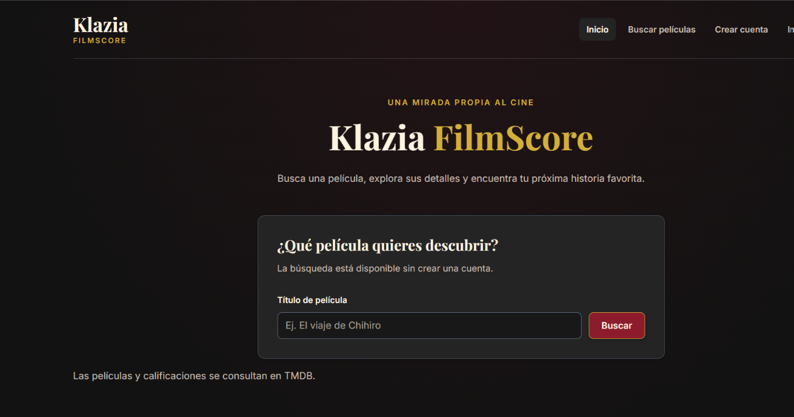

La página pública presenta el buscador de películas, que puede utilizarse sin
crear una cuenta, y la navegación hacia las demás vistas de la aplicación.

### Búsqueda pública por título

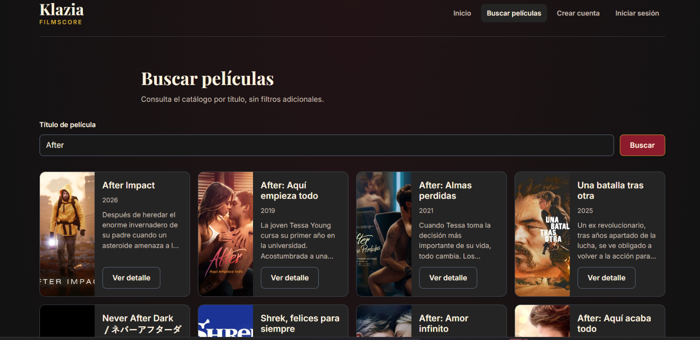

La búsqueda está disponible para una persona invitada. El campo consulta el
catálogo por el título escrito; no busca por género, actor ni otros filtros.

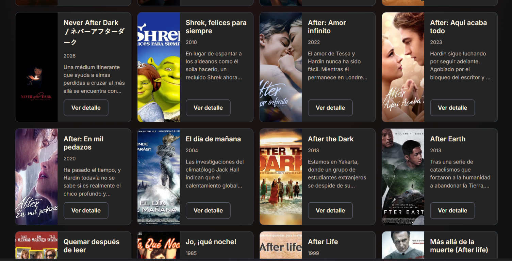

La lista muestra coincidencias adicionales de TMDB para la misma búsqueda.
Para abrir el detalle de una película tampoco se requiere iniciar sesión.

### Detalle público y opciones privadas

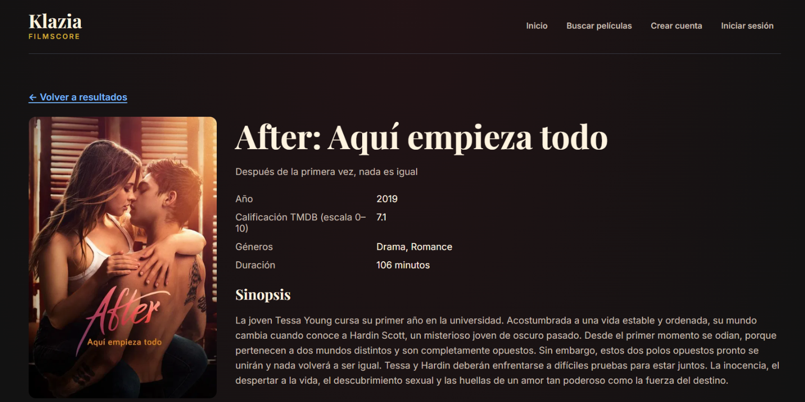

Las personas invitadas y las autenticadas pueden consultar el detalle de una
película. La calificación de TMDB aparece en escala de 0 a 10.

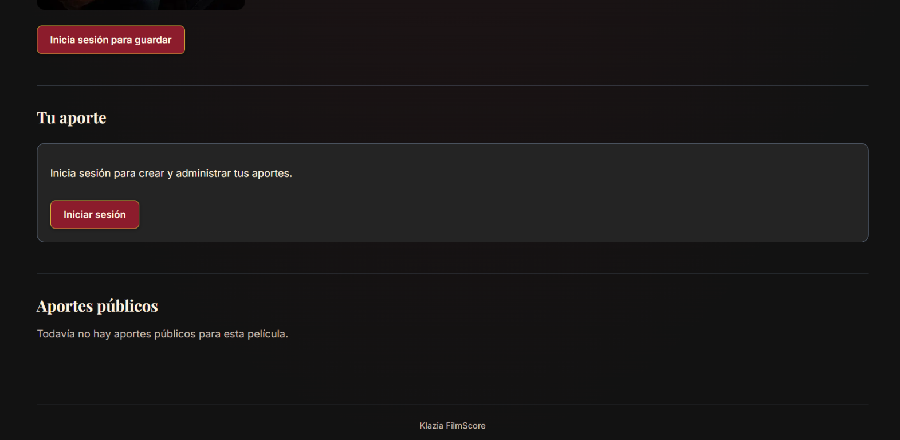

Las acciones privadas no están disponibles para invitados: guardar favoritos,
calificar y escribir reseñas requiere crear una cuenta e iniciar sesión.

### Crear una cuenta

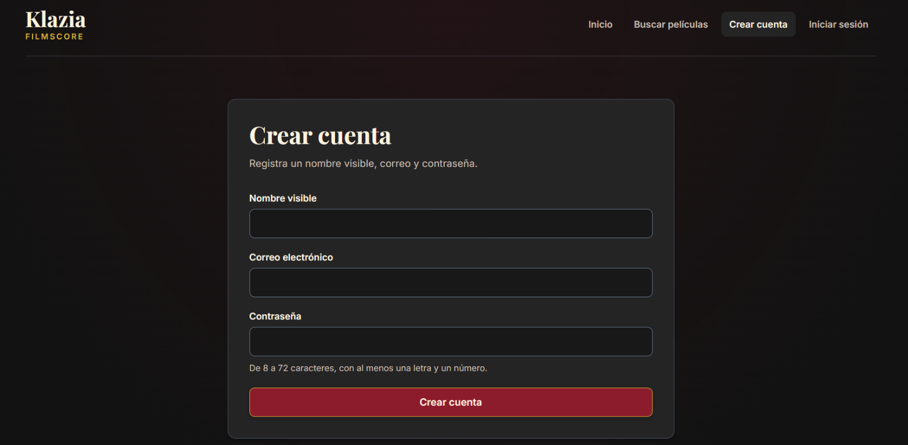

Una persona invitada puede registrarse con nombre visible, correo y
contraseña. Al completar el registro, la aplicación muestra una confirmación y
limpia la contraseña, pero no inicia sesión ni navega automáticamente al
formulario de acceso. Para continuar, debe elegir «Iniciar sesión» en la parte
superior derecha e ingresar el correo y la contraseña de su cuenta.

### Iniciar sesión

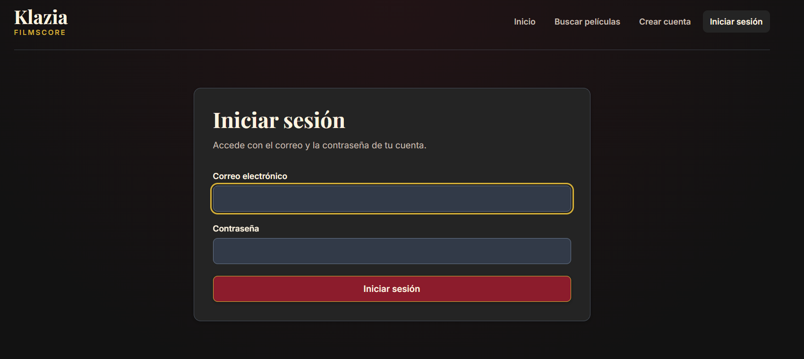

La opción «Iniciar sesión» está en la parte superior derecha cuando no hay una
sesión activa. El formulario solicita el correo y la contraseña de la cuenta.

### Sesión autenticada

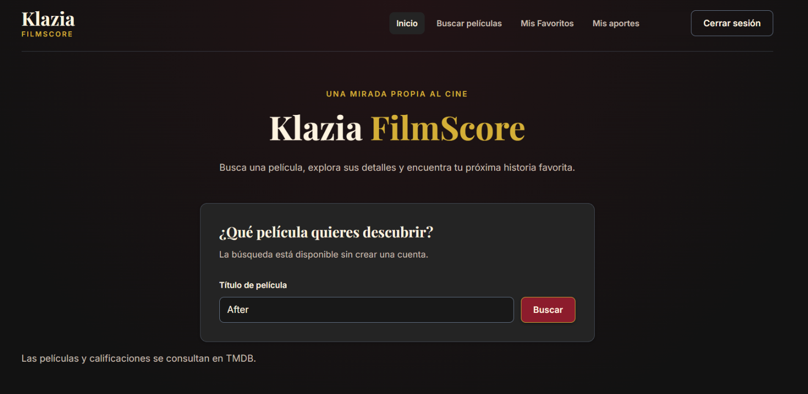

Después de iniciar sesión, el encabezado ofrece «Mis Favoritos», «Mis aportes»
y «Cerrar sesión». El espacio donde aparece el nombre visible se dejó sin
contenido en esta captura para proteger la identidad de la cuenta.

### Favorito agregado por una cuenta autenticada

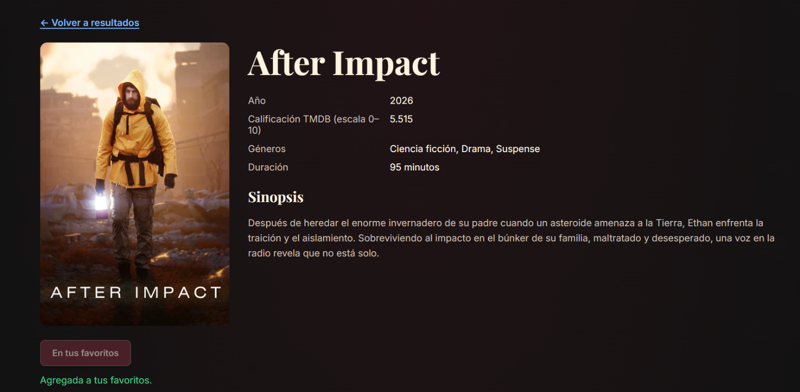

Quien inició sesión puede guardar una película desde su detalle; la interfaz
confirma que quedó agregada a sus favoritos.

### Lista privada de favoritos

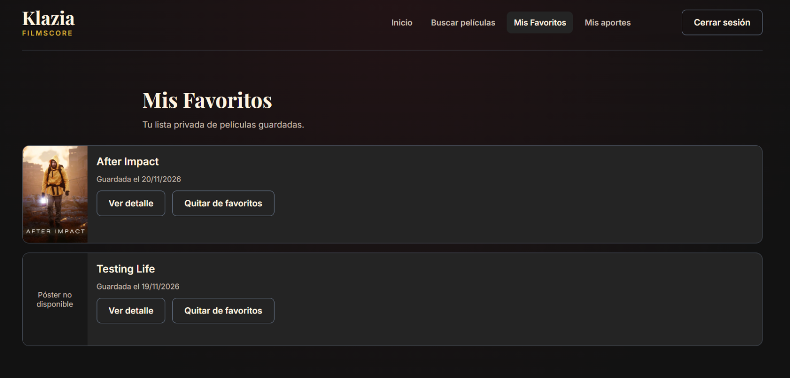

La lista muestra las películas guardadas por la cuenta autenticada y permite
abrir su detalle o retirarlas de Favoritos.

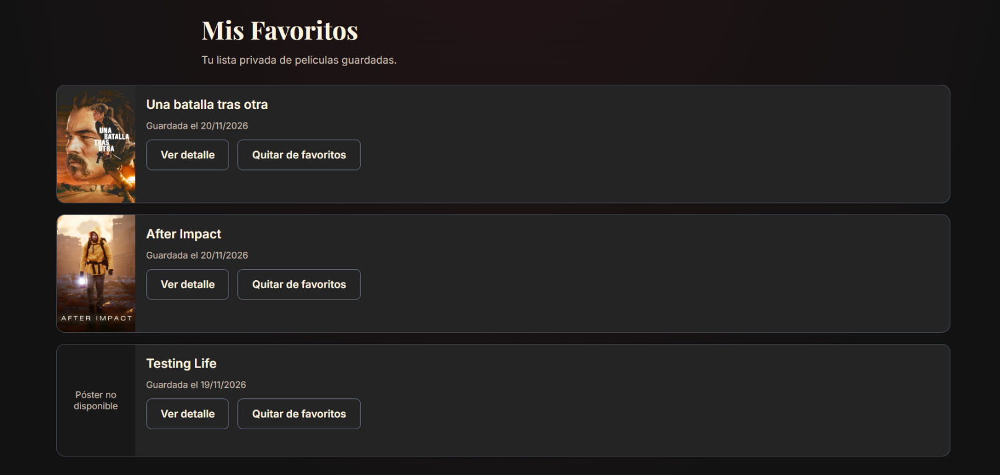

Cada elemento de «Mis Favoritos» ofrece los botones «Ver detalle» y «Quitar de
favoritos».

### Mis aportes sin registros

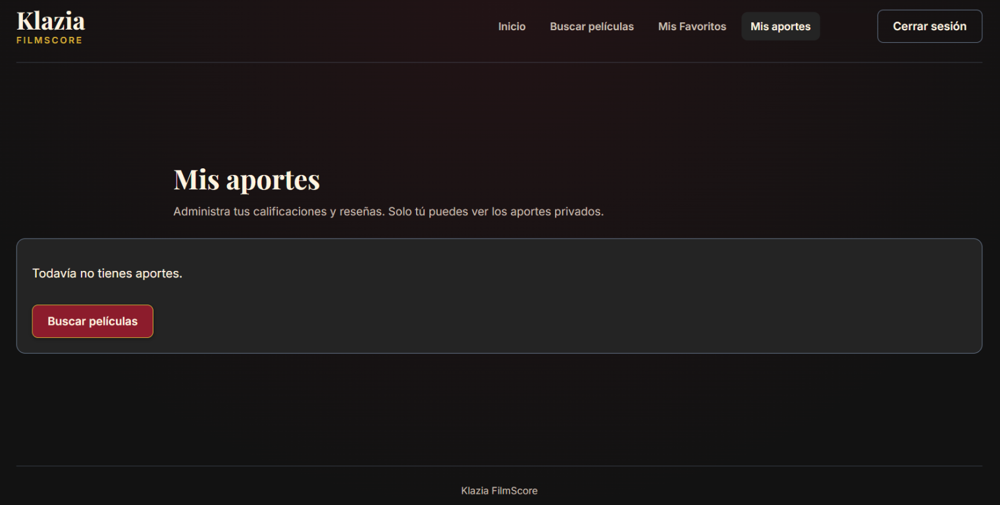

Cuando la cuenta aún no tiene aportes, la pantalla informa que la lista está
vacía y ofrece una opción para buscar películas.

### Crear un aporte

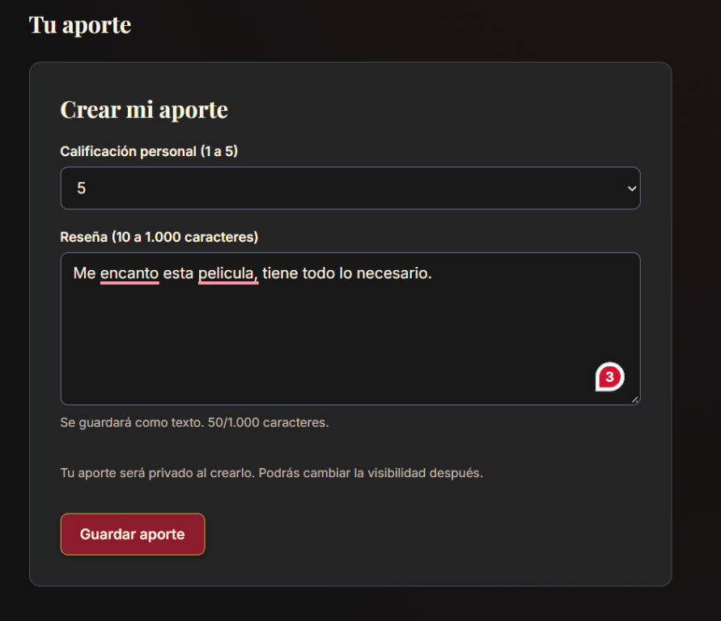

Desde el detalle de una película, quien inició sesión puede crear un aporte
con una calificación de 1 a 5 y una reseña de 10 a 1.000 caracteres. En esa
misma página también puede agregar la película a Favoritos; son acciones
independientes. El aporte se crea como **privado**.

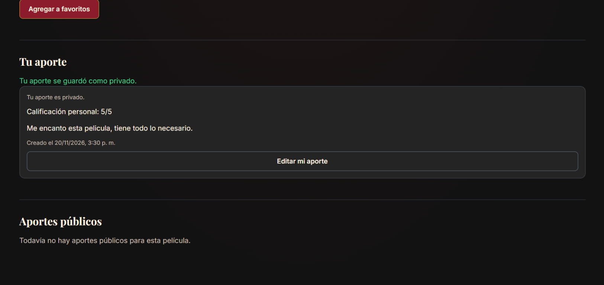

Después de guardarlo, el detalle muestra la calificación, la reseña, su estado
privado y la opción de editar el aporte.

### Editar y administrar aportes

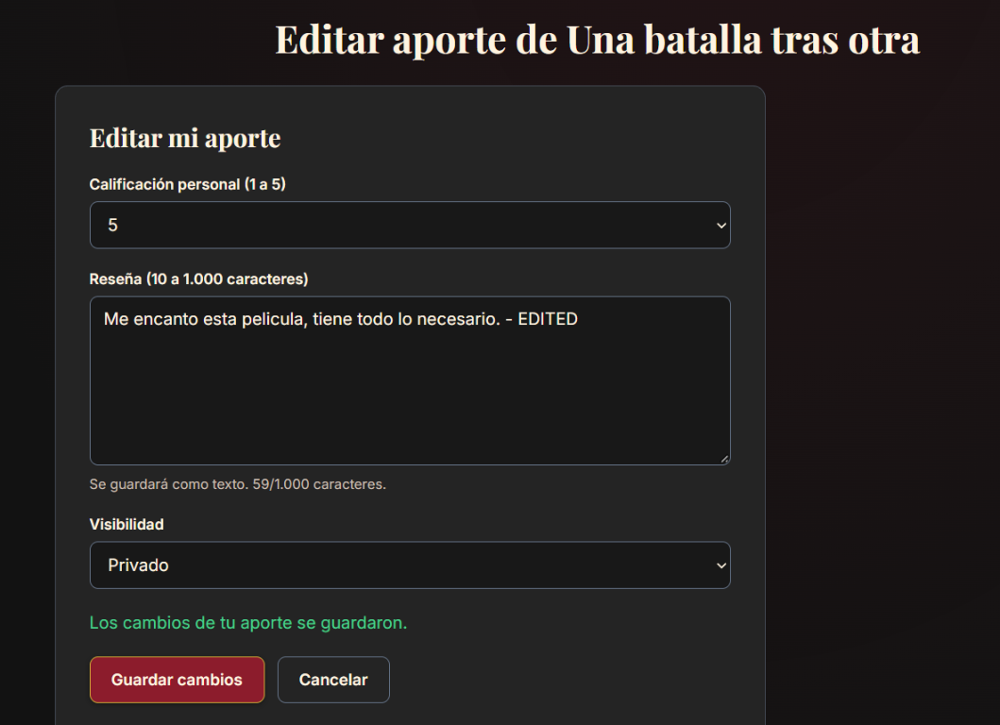

El autor puede editar su calificación y reseña, y elegir si el aporte es
privado o público.

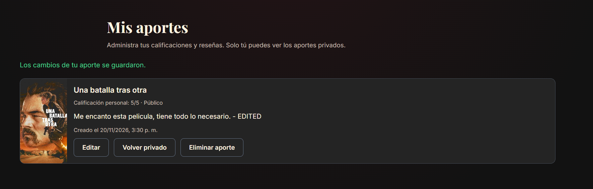

En «Mis aportes» puede revisar sus registros, editarlos, cambiar su visibilidad
o eliminarlos. Un aporte público también puede volver a ser privado.

### Aportes públicos

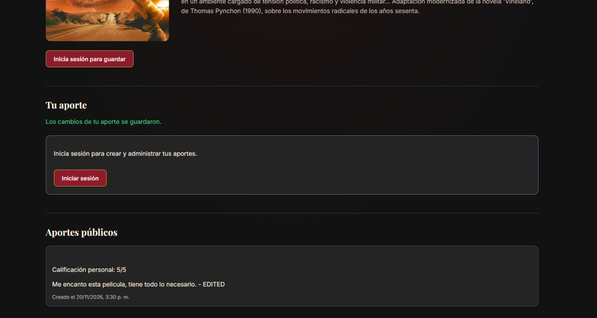

Los aportes que su autor hace públicos aparecen en el detalle de la película y
pueden leerse sin iniciar sesión. En la aplicación se muestra el nombre visible
del autor; en esta captura se ocultó por privacidad.

## Seguridad y privacidad

- Las contraseñas se guardan como hashes bcrypt mediante `bcryptjs`; no se
  devuelven en las respuestas.
- `express-session` administra sesiones en memoria. La cookie `klazia.sid`
  está configurada como `HttpOnly` y `SameSite=Lax`. `Secure` está desactivado
  en la configuración local HTTP actual; no se debe interpretar como una
  configuración lista para producción.
- CORS permite el origen indicado por `FRONTEND_ORIGIN` y habilita credenciales.
  Las solicitudes que modifican datos también validan el origen y el token
  CSRF.
- El token de TMDB se configura solo en el backend. Los errores públicos no
  exponen consultas SQL, credenciales ni detalles internos.
- No subas `.env`, tokens, contraseñas, cookies de sesión ni archivos SQLite.
  Usa solo datos sintéticos en capturas o demostraciones compartidas.

## Mejoras futuras

Estas ideas no están implementadas actualmente:

- Agregar filtros o paginación al catálogo.
- Incorporar almacenamiento persistente de sesiones y recuperación o
  eliminación de cuentas mediante decisiones de producto.
- Evaluar si el proyecto necesita administración o moderación.
- Completar verificaciones formales de responsive y rendimiento antes de
  afirmar resultados para esos requisitos.
- Verificar y completar la atribución oficial de TMDB antes de publicar.
- Redirigir al usuario al inicio de sesión después de crear su cuenta.
- Limpiar el texto de búsqueda después de realizarla.

## Atribución de TMDB

La aplicación utiliza TMDB como fuente de información sobre películas y
calificaciones. Los [términos oficiales del API de TMDB](https://www.themoviedb.org/api-terms-of-use)
requieren identificar el uso con el logotipo de TMDB, con menor prominencia
que la identidad de la aplicación, y mostrar este aviso de forma visible:

> This application uses TMDB and the TMDB APIs but is not endorsed, certified,
> or otherwise approved by TMDB.

La interfaz capturada actualmente muestra «Las películas y calificaciones se
consultan en TMDB.», pero no se ha verificado que incluya el logotipo y el aviso
oficial requeridos. Hay que completar y comprobar esa atribución en la
aplicación antes de publicar las capturas o una nueva versión. Este README no
sustituye el aviso dentro de la aplicación. TMDB no respalda ni certifica este
proyecto.

## Autor

**Hassan Esteban Cervantes Arango**  
Proyecto académico.
